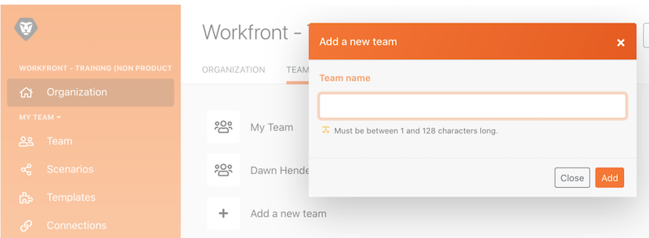

# Présentation de l’administration

Découvrez comment passer d’une organisation ou d’une équipe à l’autre et ajouter des utilisateurs ou utilisatrices au système.

## Présentation de l’administration

Dans cette vidéo, vous apprendrez :

* Comment naviguer entre les organisations et les équipes
* Comment créer des équipes
* Invitation des utilisateurs et des utilisatrices dans une organisation et une équipe

>[!VIDEO](https://video.tv.adobe.com/v/3418191/?captions=fre_fr&quality=12&learn=on&enablevpops=1)

>[!NOTE]
>
>Si votre entreprise a été intégrée à Adobe Admin Console, reportez-vous à [Ajouter des utilisateurs et utilisatrices à Adobe Workfront Fusion via Adobe Admin Console](https://experienceleague.adobe.com/fr/docs/workfront/using/adobe-workfront-fusion/fusion-in-experience-cloud/add-fusion-users-admin-console).

## Vous voulez en savoir plus ? Nous recommandons ce qui suit :

[Documentation de Workfront Fusion](https://experienceleague.adobe.com/fr/docs/workfront-fusion/using/get-started-with-fusion/understand-workfront-fusion/workfront-fusion-overview)
