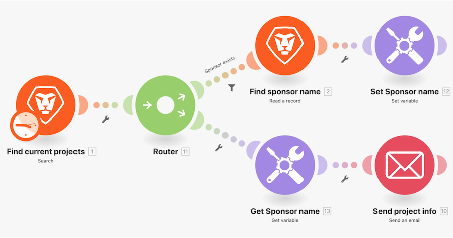

# Présentation des modules Définir/Obtenir les variables

Recherchez des informations sur un projet dans Workfront et envoyez un e-mail contenant des informations connexes.

## Présentation des variables Get/set

Workfront recommande de regarder la vidéo de présentation de l’exercice avant d’essayer de recréer l’exercice dans votre propre environnement.

>[!VIDEO](https://video.tv.adobe.com/v/3417273/?captions=fre_fr&quality=12&learn=on&enablevpops=1)

## À vous

>[!NOTE]
>
>Les exercices pratiques et les défis sont facultatifs et ne sont pas nécessaires pour terminer la formation Fusion.

Cet exercice repose sur ce que vous avez appris dans la présentation, mais la solution n’est pas fournie.

Créez un clone du scénario « Partage de variables entre les chemins de routage » que vous avez créé dans cette présentation. Envoyez par e-mail le message que vous avez rédigé aux personnes propriétaire et sponsor du projet. Vous devez également inclure la condition du projet dans le message. (Pour le moment, il est normal que la condition apparaisse sous la forme d’une clé de deux lettres.)

**Défi :** planifiez votre scénario pour envoyer cet « e-mail » chaque semaine à 8 heures du matin le lundi.

## Vous voulez en savoir plus ? Nous recommandons ce qui suit :

[Documentation de Workfront Fusion](https://experienceleague.adobe.com/fr/docs/workfront-fusion/using/get-started-with-fusion/understand-workfront-fusion/workfront-fusion-overview)
