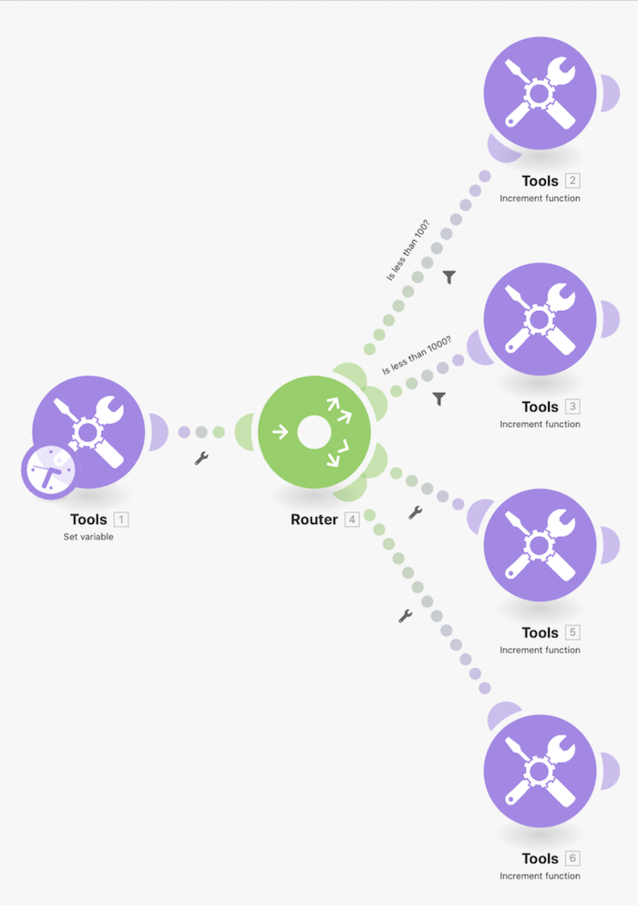

# Présentation des modèles de routage

Utilisez le module Définir la variable pour envoyer un nombre à travers plusieurs chemins afin de voir comment se comportent les filtres et les abandons lors du routage.

## Présentation des modèles de routage

Workfront recommande de regarder la vidéo de présentation de l’exercice avant d’essayer de recréer l’exercice dans votre propre environnement.

>[!VIDEO](https://video.tv.adobe.com/v/3417261/?captions=fre_fr&quality=12&learn=on&enablevpops=1)

## Vous voulez en savoir plus ? Nous recommandons ce qui suit :

[Documentation de Workfront Fusion](https://experienceleague.adobe.com/fr/docs/workfront-fusion/using/get-started-with-fusion/understand-workfront-fusion/workfront-fusion-overview)
