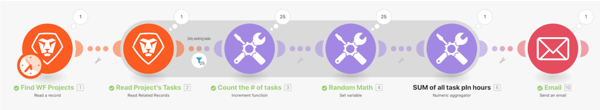

# Présentation des agrégations

## Vue d’ensemble

En utilisant le scénario « Présentation de l’itération » que vous avez créé lors de votre dernière présentation, additionnez le nombre d’heures prévues pour chaque tâche du projet et envoyez-vous un e-mail avec ces informations.

## Présentation des agrégations

Workfront recommande de regarder la vidéo de présentation de l’exercice avant d’essayer de recréer l’exercice dans votre propre environnement.

>[!VIDEO](https://video.tv.adobe.com/v/335280/?quality=12&learn=on&enablevpops=1)

## Vous voulez en savoir plus ? Nous recommandons ce qui suit :

[Documentation de Workfront Fusion](https://experienceleague.adobe.com/fr/docs/workfront-fusion/using/get-started-with-fusion/understand-workfront-fusion/workfront-fusion-overview)
