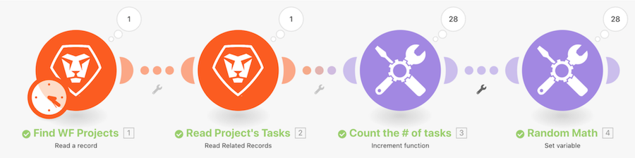

# Introduction à la présentation des itérateurs

Examinez un projet spécifique dans Workfront, puis toutes les tâches de ce projet. Vous utiliserez ensuite le module d’outil d’incrémentation pour compter le nombre de tâches dans le projet. Enfin, vous utiliserez le module Définir la variable pour soustraire le Nombre d’enfants du Nombre de problèmes en cours afin de produire une valeur numérique pour chacun des bundles de tâches.

## Introduction à la présentation des itérateurs

Workfront recommande de regarder la vidéo de présentation de l’exercice avant d’essayer de recréer l’exercice dans votre propre environnement.

>[!VIDEO](https://video.tv.adobe.com/v/3417297/?captions=fre_fr&quality=12&learn=on&enablevpops=1)

## Vous voulez en savoir plus ? Nous recommandons ce qui suit :

[Documentation de Workfront Fusion](https://experienceleague.adobe.com/fr/docs/workfront-fusion/using/get-started-with-fusion/understand-workfront-fusion/workfront-fusion-overview)
