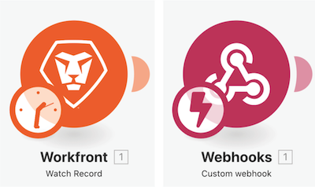
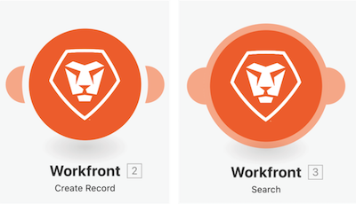

# Familiarisez-vous avec les applications supplémentaires et les modules courants.

## Rappel sur les types de module

### Modules déclencheurs

Peut uniquement être utilisé comme premier module et peut renvoyer zéro, un ou plusieurs bundles qui seront traités individuellement dans les modules suivants, sauf s’ils sont agrégés.

* **Déclencheur instantané** (Déclencheur avec éclair)—déclenché immédiatement en fonction du webhook.
* **Déclencheur planifié** (Horodatage au déclenchement)—fonctionnalités spéciales pour effectuer le suivi du dernier enregistrement traité.

### Actions et modules de recherche

* **Action** — Utilisé pour effectuer des opérations CRUD (création, lecture, mise à jour et suppression).
* **Recherches** : utilisé pour rechercher zéro, un ou plusieurs enregistrements et les renvoyer sous forme de bundles qui seront traités individuellement dans les modules suivants, sauf si agrégés.

### Familiarisez-vous avec les applications supplémentaires et les modules courants.

Dans cette vidéo, vous apprendrez :

* En quoi consistent les déclencheurs, les actions et les recherches et en quoi ils diffèrent
* Types de modules trouvés dans différents connecteurs d’applications et leur fonctionnement

>[!VIDEO](https://video.tv.adobe.com/v/335287/?quality=12&learn=on&enablevpops=1)
