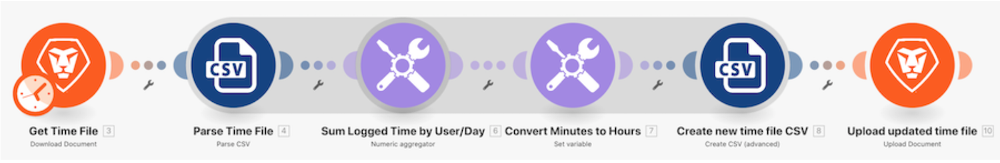

# Présentation des structures de données

Ouvrez un fichier CSV contenant une liste d’entrées de temps. Ces entrées de temps correspondent à des minutes enregistrées tout au long de certains jours par plusieurs utilisateurs et utilisatrices. L’objectif est de prendre ces informations et de produire un nouveau fichier CSV qui montre le temps total, en heures, enregistré par chaque utilisateur ou utilisatrice, chaque jour.

## Présentation des structures de données

Workfront recommande de regarder la vidéo de présentation de l’exercice avant d’essayer de recréer l’exercice dans votre propre environnement.

>[!VIDEO](https://video.tv.adobe.com/v/335294/?quality=12&learn=on&enablevpops=1)

## Vous voulez en savoir plus ? Nous recommandons ce qui suit :

[Documentation de Workfront Fusion](https://experienceleague.adobe.com/fr/docs/workfront-fusion/using/get-started-with-fusion/understand-workfront-fusion/workfront-fusion-overview)
