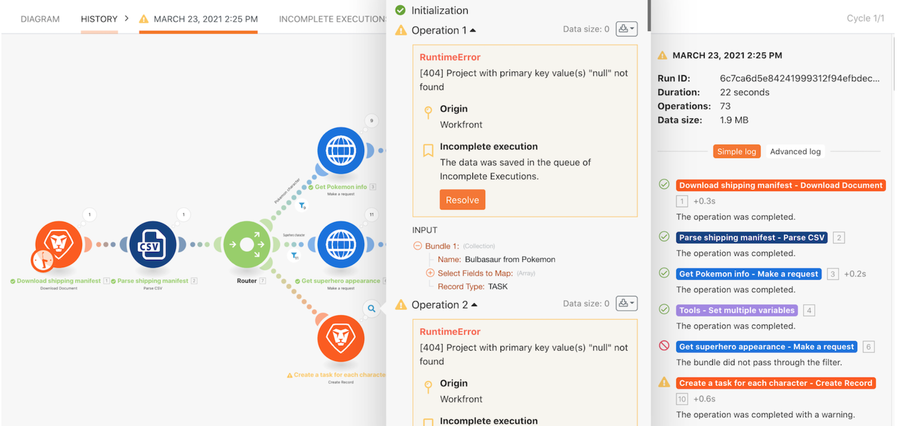

# Présentation des exécutions incomplètes

Prenez l’habitude de stocker les exécutions incomplètes et découvrez la valeur qu’apporte la réexécution des bundles après l’évaluation et la correction des erreurs.

## Présentation des exécutions incomplètes

Workfront recommande de regarder la vidéo de présentation de l’exercice avant d’essayer de recréer l’exercice dans votre propre environnement.

>[!VIDEO](https://video.tv.adobe.com/v/335308/?quality=12&learn=on&enablevpops=1)

## Vous voulez en savoir plus ? Nous recommandons ce qui suit :

[Documentation de Workfront Fusion](https://experienceleague.adobe.com/fr/docs/workfront-fusion/using/get-started-with-fusion/understand-workfront-fusion/workfront-fusion-overview)
