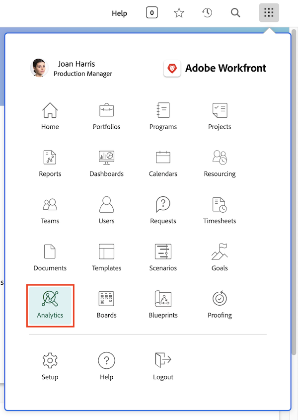

# Accéder à Analytique améliorée

Comme pour la plupart des autres fonctionnalités de Workfront, vous pouvez accéder à [!UICONTROL Analytique améliorée] depuis le menu principal. Toutefois, l’option [!UICONTROL Analytique] ne figure pas par défaut dans le menu principal.

Si vous ne la voyez pas ici, votre équipe d’administration système ou de groupes devra l’ajouter pour vous. Elle utilisera pour cela un modèle de mise en page. La vidéo ci-dessous explique comment procéder.

## Ajouter Analytics aux modèles de mise en page

Dans cette vidéo, vous découvrirez comment les administrateurs et administratrices système et de groupes accordent l’accès à [!UICONTROL Analytics] dans Workfront.

>[!VIDEO](https://video.tv.adobe.com/v/335045/?quality=12&learn=on&enablevpops=1)

Toute personne disposant d’une licence Workfront (dans les formules [!UICONTROL Workfront Business] ou supérieures) peut accéder à [!UICONTROL Analytics] une fois ajoutée au modèle de mise en page qui lui a été attribué. Cependant, vous ne verrez les projets et les informations sur les utilisateurs et les utilisatrices que si votre niveau d’accès Workfront et que les autorisations de partage sur des projets et des utilisateurs et utilisatrices spécifiques vous le permettent.
